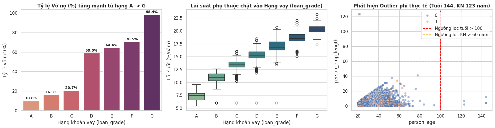
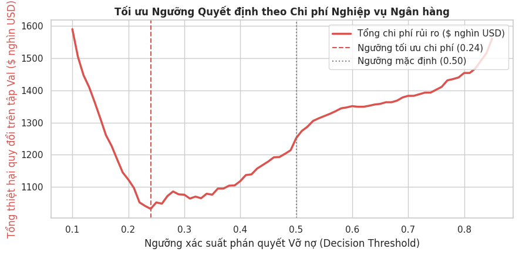
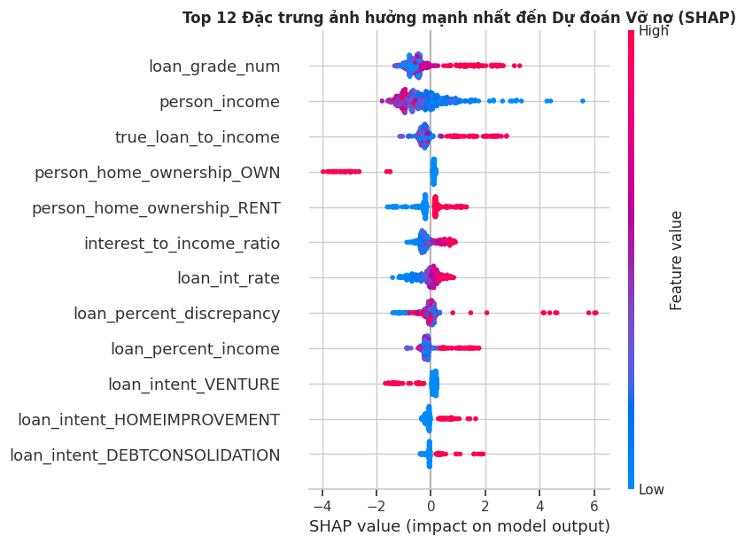
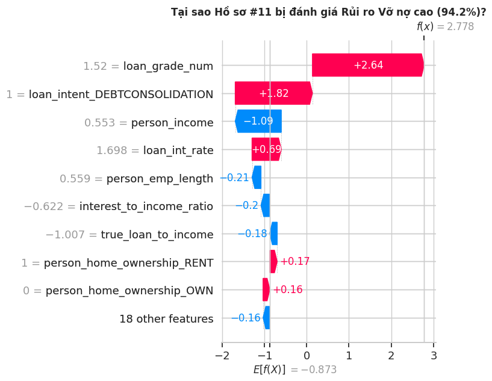

# Credit Risk Scoring: Dự báo khả năng vỡ nợ khoản vay

Dự án Machine Learning cổ điển trên dữ liệu bảng: dự đoán xác suất một khoản vay cá nhân bị vỡ nợ. Dự án so sánh **Logistic Regression → Random Forest → XGBoost → Ensemble (XGBoost + LightGBM + Random Forest)**, chọn **ngưỡng quyết định theo chi phí kinh doanh** thay vì mặc định 0.5, giải thích dự đoán bằng **SHAP**, và có kèm app **Streamlit** để chấm điểm từng hồ sơ.

Mô hình được huấn luyện trên **Google Colab Pro**. Mọi số liệu trong README này lấy trực tiếp từ output của notebook [`Credit_Risk_XGBoost_Colab.ipynb`](Credit_Risk_XGBoost_Colab.ipynb).

---

## 1. Bài toán

Ngân hàng nhận hồ sơ vay và cần quyết định cho vay hay không. Có hai loại sai lầm, và **chi phí của chúng không bằng nhau**:

| Sai lầm | Ý nghĩa | Chi phí giả định |
|---|---|---|
| **False Negative (FN)** | Cho vay người sau đó vỡ nợ | **\$5,000** / hồ sơ |
| **False Positive (FP)** | Từ chối nhầm người trả nợ tốt | **\$1,000** / hồ sơ (mất lãi) |

> Hai con số chi phí này là **giả định để minh họa**, không phải số liệu của một ngân hàng thật. Nếu thay tỷ lệ chi phí thì ngưỡng tối ưu cũng sẽ thay đổi.

Mục tiêu:
1. Model phân biệt tốt khách vỡ nợ và khách trả tốt (đo bằng ROC-AUC và PR-AUC).
2. Chọn ngưỡng cho tổng chi phí thấp nhất.
3. Giải thích được vì sao một hồ sơ bị đánh giá rủi ro cao.

---

## 2. Dữ liệu

- **Nguồn:** [Credit Risk Dataset (Kaggle: laotse/credit-risk-dataset)](https://www.kaggle.com/datasets/laotse/credit-risk-dataset)
- **Gốc:** 32,581 dòng × 12 cột. Tỷ lệ vỡ nợ **21.82%** (dữ liệu mất cân bằng).
- **Thiếu dữ liệu:** `loan_int_rate` thiếu 3,116 dòng, `person_emp_length` thiếu 895 dòng.
- **Dữ liệu bẩn phát hiện qua EDA:** có người 144 tuổi, có người đi làm 123 năm.



---

## 3. Pipeline

```
credit_risk_dataset.csv (32,581 dòng)
        │
        ▼
[1] Làm sạch
    - Bỏ 165 dòng trùng lặp
    - Bỏ 7 outlier: tuổi > 100, số năm đi làm > 60, hoặc số năm đi làm > tuổi − 14
    → còn 32,409 dòng
        │
        ▼
[2] Chia tập TRƯỚC khi tính bất kỳ thống kê nào (chống data leakage)
    Train 70% (22,686) · Val 15% (4,861) · Test 15% (4,862), có stratify theo nhãn
        │
        ▼
[3] Điền khuyết: dùng thống kê CHỈ học từ tập Train
    - loan_int_rate: điền bằng median theo từng hạng vay (A: 7.49% → G: 20.11%)
    - person_emp_length: điền bằng median
    - Thêm cờ int_rate_missing, emp_length_missing
        │
        ▼
[4] Feature engineering → tổng cộng 27 đặc trưng
    true_loan_to_income, loan_percent_discrepancy, annual_interest_amount,
    interest_to_income_ratio, income_per_emp_year, cred_hist_to_adult_age,
    loan_grade_num, prior_default_flag + StandardScaler + One-Hot
        │
        ▼
[5] Train & so sánh 7 mô hình (Val dùng cho early stopping, Test chỉ dùng để chấm điểm)
        │
        ▼
[6] Chọn ngưỡng theo chi phí trên tập Val → kiểm tra lại trên Test
        │
        ▼
[7] SHAP giải thích  →  Đóng gói artifacts (.pkl)  →  Streamlit app
```

**Tại sao điền lãi suất theo hạng vay?** Lãi suất phụ thuộc rất chặt vào hạng vay (biểu đồ giữa ở phần EDA). Nếu điền bằng median chung thì một khoản vay hạng G sẽ bị gán lãi suất của hạng B, khiến dữ liệu sai lệch.

---

## 4. Kết quả: 7 mô hình trên tập Test (ngưỡng 0.50)

| # | Mô hình | Val ROC-AUC | Test ROC-AUC | Test PR-AUC | Test F1 | Precision | Recall |
|---|---|:-:|:-:|:-:|:-:|:-:|:-:|
| 1 | **XGBoost (Tuned + Regularized)** | 0.9558 | **0.9546** | **0.9143** | 0.8384 | 94.04% | 75.63% |
| 2 | Stacking (XGB + LGB + RF → Meta LR) | 0.9556* | 0.9534 | 0.9120 | 0.8389 | 93.73% | 75.92% |
| 3 | Soft-Voting (0.45 XGB + 0.35 LGB + 0.20 RF) | 0.9551 | 0.9528 | 0.9113 | 0.8400 | **94.58%** | 75.54% |
| 4 | LightGBM (Tuned) | 0.9556 | 0.9524 | 0.9103 | 0.8373 | 94.34% | 75.26% |
| 5 | XGBoost (Default) | 0.9555 | 0.9510 | 0.9130 | **0.8464** | 94.02% | 76.95% |
| 6 | Random Forest | 0.9427 | 0.9359 | 0.8885 | 0.8219 | 91.08% | 74.88% |
| 7 | Logistic Regression (Baseline) | 0.8889 | 0.8688 | 0.7206 | 0.6250 | 52.07% | **78.17%** |

\* Meta-learner của Stacking được fit trên tập Val, nên con số Val của nó bị lạc quan. Chỉ nên tin con số Test.

**Nhận xét:**
- **Mô hình cây vượt xa mô hình tuyến tính.** Logistic Regression chỉ đạt Precision 52%: gần một nửa số lần nó cảnh báo "vỡ nợ" là cảnh báo sai.
- **XGBoost Tuned tốt nhất về ROC-AUC/PR-AUC.** Model dừng ở cây thứ 627 nhờ early stopping. Val và Test chỉ chênh 0.0012 ROC-AUC, tức là không overfit vào tập Val.
- **Ensemble KHÔNG thắng XGBoost đơn lẻ.** Ba mô hình đều dạng cây, học trên cùng một bộ đặc trưng, nên chúng sai ở những chỗ giống nhau và không bù trừ được cho nhau. Random Forest yếu hơn nhưng vẫn chiếm 20% trọng số. Ensemble chỉ hơn ở Precision.
- **Nếu triển khai thật, tôi sẽ chọn XGBoost đơn lẻ:** đơn giản hơn, nhanh hơn, dễ giải thích hơn mà không kém về chất lượng.

---

## 5. Chọn ngưỡng theo chi phí

$$\text{Tổng chi phí} = FN \times 5000 + FP \times 1000$$

Thử 76 ngưỡng từ 0.10 đến 0.85 trên **tập Val** (dùng xác suất của Soft-Voting), chọn ngưỡng có tổng chi phí thấp nhất, rồi mới kiểm tra lại trên **tập Test**:



| Ngưỡng | Bắt được vỡ nợ | Recall | FN | FP | Tổng chi phí trên Test |
|:-:|:-:|:-:|:-:|:-:|:-:|
| 0.50 (mặc định) | 803 / 1,063 | 75.5% | 260 | 46 | \$1,346,000 |
| **0.24 (tối ưu chi phí)** | **913 / 1,063** | **85.9%** | **150** | 370 | **\$1,120,000** |

→ **Tiết kiệm \$226,000 trên tập Test.**

**Cái giá phải trả:** hạ ngưỡng giúp bắt thêm 110 ca vỡ nợ, nhưng phải từ chối nhầm thêm 324 khách tốt. Precision giảm từ khoảng 94.6% xuống khoảng 71%. Đổi như vậy vẫn có lời vì 1 FN đắt gấp 5 lần 1 FP. (Ngưỡng tối ưu F1 trên Val là 0.49, gần với mặc định.)

---

## 6. Giải thích bằng SHAP

### Toàn cục (XGBoost, 400 hồ sơ Test)


- **`loan_grade_num`** quan trọng nhất: hạng vay càng xấu thì rủi ro càng cao.
- **`person_income`**: thu nhập thấp làm tăng rủi ro.
- **`true_loan_to_income`** (đặc trưng tự tạo) xếp thứ 3: tỷ lệ nợ trên thu nhập càng cao thì càng rủi ro.
- **`person_home_ownership_OWN = 1`** kéo rủi ro xuống rất mạnh. Người có nhà riêng hiếm khi vỡ nợ.
- **`loan_intent_VENTURE = 1`** lại làm giảm rủi ro. Đây là quy luật riêng của dataset này, không nên tổng quát hóa ra ngoài.
- **`loan_percent_discrepancy`** có vài điểm lệch hẳn lên +4 đến +6. Đặc trưng này đo độ chênh giữa cột `loan_percent_income` có sẵn và tỷ lệ tính lại. Chênh lớn nghĩa là dữ liệu nhập không nhất quán, và model đã học được rằng đây là tín hiệu rủi ro.

### Một hồ sơ cụ thể (hồ sơ #11, xác suất vỡ nợ 94.2%)


Xuất phát từ mức trung bình `E[f(X)] = −0.873` log-odds (khoảng 29.5%):
- Hạng vay xấu: **+2.64**
- Mục đích vay là gộp nợ (DEBTCONSOLIDATION): **+1.82**
- Lãi suất cao: **+0.69**
- Thu nhập khá: **−1.09**

Kết quả cuối `f(x) = 2.778` log-odds, tương đương khoảng **94%**. Các giá trị xám bên trái là giá trị đã chuẩn hóa.

---

## 7. Cấu trúc thư mục

```
credit-risk-scoring/
├── Credit_Risk_XGBoost_Colab.ipynb  # Notebook chính, chạy trên Google Colab (có sẵn output)
├── train.py                         # Tái lập pipeline của notebook dưới dạng script
├── app.py                           # Streamlit app chấm điểm hồ sơ
├── src/features.py                  # Feature engineering dùng chung cho train.py và app.py
├── metrics_summary.json             # Số liệu kết quả
├── assets/                          # Biểu đồ xuất từ notebook
├── models/                          # Chứa credit_risk_artifacts.pkl (không commit lên git)
├── requirements.txt
└── README.md
```

---

## 8. Cách chạy

```bash
git clone <repo-url> && cd credit-risk-scoring
python3 -m venv .venv && source .venv/bin/activate
pip install -r requirements.txt

# 1. Tạo model: tự tải dữ liệu từ Kaggle (kagglehub) và train trên CPU
python train.py
#    hoặc: tải credit_risk_artifacts.pkl từ Colab về và đặt vào models/

# 2. Chạy app
streamlit run app.py
```

**Notebook:** mở `Credit_Risk_XGBoost_Colab.ipynb` trên Google Colab và chọn *Run all*.

> File `.pkl` không được commit lên git vì kích thước lớn và phụ thuộc phiên bản thư viện. Nếu dùng file `.pkl` từ Colab, môi trường local nên có cùng phiên bản `xgboost` / `lightgbm` / `scikit-learn` với Colab (trên Colab: XGBoost 3.4.1, LightGBM 4.6.0).

---

## 9. Tech stack

| Hạng mục | Công cụ |
|---|---|
| Ngôn ngữ | Python 3.13 |
| Mô hình | XGBoost, LightGBM, scikit-learn (Logistic Regression, Random Forest) |
| Giải thích | SHAP (TreeExplainer) |
| Xử lý dữ liệu | pandas, numpy |
| Trực quan | matplotlib, seaborn |
| App | Streamlit |
| Môi trường train | Google Colab Pro |

---

## 10. Hạn chế đã biết & hướng phát triển

**Hạn chế:**
- **Stacking dùng blending trên tập Val, chưa phải out-of-fold thật.** Cách đúng là sinh xác suất bằng K-fold trên tập Train rồi mới fit meta-learner.
- **Tập Val bị dùng cho nhiều việc:** early stopping, fit meta-learner và chọn ngưỡng. Kết quả trên Test vẫn độc lập, nhưng tách thêm một tập calibration riêng sẽ sạch hơn.
- **Trọng số Soft-Voting (0.45/0.35/0.20) được đặt tay**, không phải tối ưu.
- **Chi phí FN/FP là giả định.** Dataset từ Kaggle không có thông tin thời gian nên không kiểm tra được hiện tượng drift theo thời gian.
- **Ngưỡng được tối ưu cho xác suất của Soft-Voting.** Nếu đổi sang dùng XGBoost đơn lẻ thì cần chọn lại ngưỡng.
- **SHAP chỉ giải thích XGBoost**, không giải thích toàn bộ ensemble.

**Hướng phát triển:**
- [ ] Stacking out-of-fold thật bằng `StratifiedKFold`
- [ ] Tối ưu siêu tham số bằng Optuna
- [ ] Calibration xác suất (isotonic / Platt) trước khi chọn ngưỡng
- [ ] Đóng gói thành API bằng FastAPI + Docker

---

**Tác giả:** Lê Công Anh Dũng · dunguzumaki@gmail.com
